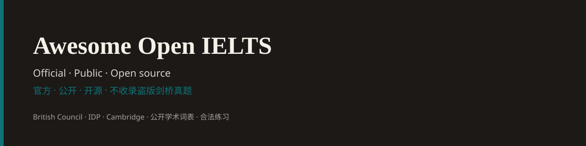

  

# Awesome Open IELTS

> A curated list of **official, public, and open-source** IELTS resources. **No pirated Cambridge papers.**
>
> 官方、公开、开源的雅思备考资源精选。不收录盗版剑桥真题。

English: [README.en.md](README.en.md)

IELTS 由 [British Council](https://takeielts.britishcouncil.org)、[IDP IELTS](https://ielts.idp.com) 与 [Cambridge University Press & Assessment](https://www.cambridgeenglish.org/exams-and-tests/ielts/) 共同举办。网上高星 GitHub 列表经常把剑桥真题 PDF 当「资源」——那是盗版，也过时。这份清单只收 **可以合法打开** 的东西。

本仓库由 [EasyIELTS](https://easyielts.cn/?utm_source=github&utm_medium=awesome_list&utm_campaign=open_ielts_2026_08) 维护。EasyIELTS 做中文考生的口语 / 写作练习，**与雅思官方无隶属或代言关系**。产品链接放在「练习与反馈」，不放进官方分类。

## 目录

- [30 分钟上手](#30-分钟上手)
- [官方入口](#官方入口)
- [考试形式（2026）](#考试形式2026)
- [评分标准](#评分标准)
- [听力 Listening](#听力-listening)
- [阅读 Reading](#阅读-reading)
- [写作 Writing](#写作-writing)
- [口语 Speaking](#口语-speaking)
- [词汇与语法](#词汇与语法)
- [词典、语料、搭配](#词典语料搭配)
- [YouTube / 播客 / 中文视频](#youtube--播客--中文视频)
- [开源项目与工具](#开源项目与工具)
- [中国大陆报名与考务](#中国大陆报名与考务)
- [四周免费备考路径](#四周免费备考路径)
- [正版该买什么](#正版该买什么)
- [本仓库不收录什么](#本仓库不收录什么)
- [贡献](#贡献)

## 30 分钟上手

1. 读官方 [口语评分细则 PDF](https://ielts.org/cdn/ielts-guides/ielts-speaking-band-descriptors.pdf) 和 [写作评分细则 PDF](https://ielts.org/cdn/Guides/ielts-writing-band-descriptors.pdf)（各约 10 分钟）。后面所有练习都对着这四项打。
2. 做一套官方样题：[Academic sample questions](https://ielts.org/take-a-test/preparation-resources/sample-test-questions/academic-test)。
3. 若准备机考，再跑 [British Council familiarisation test](https://takeielts.britishcouncil.org/prepare/ielts-free-practice-mock-tests/ielts-familiarisation-test)，熟悉屏幕、高亮和倒计时。
4. 开口：用 [EasyIELTS 30 秒 Part 1 快练](https://easyielts.cn/speaking-practice?topicId=26&part=1&mode=single&utm_source=github&utm_medium=awesome_list&utm_campaign=open_ielts_2026_08) 录一道，对照口语四维（流利 / 词汇 / 语法 / 发音）看自己卡在哪。

听力和阅读可以自对答案；口语和写作没有反馈等于没练。

## 官方入口

三方主办，权威从这里开始。

- [IELTS.org](https://ielts.org) — 全球官网：报名入口、样题、成绩解释、政策。
- [Sample test questions](https://ielts.org/take-a-test/preparation-resources/sample-test-questions) — 官方样题总入口（Academic / General Training / Life Skills）。
- [Academic sample tests](https://ielts.org/take-a-test/preparation-resources/sample-test-questions/academic-test) — 留学最常用的 A 类样题。
- [General Training sample tests](https://ielts.org/take-a-test/preparation-resources/sample-test-questions/general-training-test) — 移民 / 工作用 G 类样题。
- [Scoring in detail](https://ielts.org/take-a-test/your-results/ielts-scoring-in-detail) — 9 级量表、总分四舍五入规则、听读约合分数。
- [Ways to take IELTS](https://ielts.org/take-a-test/why-choose-ielts/ways-to-take-ielts) — 机考、纸笔、Online、Writing on Paper。
- [Test types](https://ielts.org/take-a-test/test-types) — Academic / GT / UKVI / Life Skills。
- [Preparation resources](https://ielts.org/take-a-test/preparation-resources) — 官方备考材料汇总。
- [Guide for test takers (PDF)](https://ielts.org/cdn/ielts-guides/ielts-guide-for-test-takers.pdf) — 考生手册。
- [Guide for teachers (PDF)](https://ielts.org/cdn/ielts-guides/ielts-guide-for-teachers.pdf) — 教师手册，内含完整 band descriptors。
- [British Council · Take IELTS](https://takeielts.britishcouncil.org) — BC 报名与备考。
- [BC free mock tests](https://takeielts.britishcouncil.org/prepare/ielts-free-practice-mock-tests) — 免费模考（含真实题型界面）。
- [BC Academic mocks](https://takeielts.britishcouncil.org/prepare/ielts-free-practice-mock-tests/academic) — A 类分技能练习。
- [BC familiarisation test](https://takeielts.britishcouncil.org/prepare/ielts-free-practice-mock-tests/ielts-familiarisation-test) — 机考界面熟悉卷。听读可出分，写说官方不自动评分。
- [BC computer practice tests](https://takeielts.britishcouncil.org/take-ielts/prepare/free-ielts-english-practice-tests/ielts-on-computer/practice-tests) — 机考操作练习。
- [IDP IELTS](https://ielts.idp.com) — IDP 官网（中国大陆考务不走 IDP，见下方「中国大陆」）。
- [IDP Prepare](https://ielts.idp.com/prepare) — IDP 备考中心：模考、播客、视频。
- [IDP new practice tests](https://ielts.idp.com/about/practice-tests/new-practice-tests) — 机考熟悉题 + 答案。
- [IDP familiarisation tests](https://ielts.idp.com/about/ielts-familiarisation-tests) — 听 / 读 / 写机考熟悉。
- [Cambridge English · IELTS](https://www.cambridgeenglish.org/exams-and-tests/ielts/) — 命题方介绍与备考产品。
- [Write & Improve](https://writeandimprove.com) — Cambridge 免费写作练习（CEFR 反馈；IELTS 专项有 Test Zone）。
- [Speak & Improve](https://speakandimprove.com/) — Cambridge 免费口语练习（剑桥大学研究项目，CEFR 自动评分）。
- [LearnEnglish (British Council)](https://learnenglish.britishcouncil.org) — 通用英语技能，听读材料质量高。
- [IELTS Official YouTube](https://www.youtube.com/user/IELTSOfficial) — 官方频道。

## 考试形式（2026）

官方 2026 年更新（以 [IELTS.org 公告](https://ielts.org/news-and-insights/updates-to-ielts-test-delivery) 为准，各地切换时间不同）：

- 全球：**中期起逐步取消纸笔全卷**，改为考点机考。
- 部分市场提供 [Writing on Paper](https://ielts.org/take-a-test/test-types/ielts-on-computer-writing-on-paper)：听读在电脑，写作题在屏幕、答在纸上。UKVI **没有** 这一选项。
- 机考出分通常 1–5 天。
- [One Skill Retake](https://ielts.org/take-a-test/test-types) 允许只重考一科；Writing on Paper 的重考必须用同一作答方式。
- **中国大陆（BC 中文官网 2026 年公告）**：UKVI 已于 **2026-07-01** 停纸笔；普通雅思 **2026-09-01** 停纸笔，之后全部机考。详见 [纸笔考试说明](https://www.chinaielts.org/about-ielts/ways-to-take-ielts/paper/iop-test-date)。

四科时间（Academic / GT 相同结构，读写材料不同）：

| 科目 | 时间 | 题量 |
|---|---|---|
| Listening | 约 30 分钟 | 4 段录音，40 题 |
| Reading | 60 分钟 | 3 篇，40 题 |
| Writing | 60 分钟 | Task 1 + Task 2（Task 2 权重大） |
| Speaking | 11–14 分钟 | Part 1 / 2 / 3，真人考官 |

听力与口语 Academic / GT **同一套**；阅读与写作不同。

## 评分标准

先把标准读懂，再刷题。这是公开的考官量表，不是机构总结。

- [Writing band descriptors (PDF)](https://ielts.org/cdn/Guides/ielts-writing-band-descriptors.pdf) — Task 1 / Task 2 四维：TA 或 TR、CC、LR、GRA。
- [Writing key assessment criteria (PDF)](https://ielts.org/cdn/Guides/ielts-writing-key-assessment-criteria.pdf)
- [Speaking band descriptors (PDF)](https://ielts.org/cdn/ielts-guides/ielts-speaking-band-descriptors.pdf) — FC、LR、GRA、Pronunciation。
- [Speaking key assessment criteria (PDF)](https://ielts.org/cdn/ielts-guides/ielts-speaking-key-assessment-criteria.pdf)
- [Institutions: sample scripts + examiner comments](https://ielts.org/organisations/ielts-for-organisations/understanding-ielts-scoring/resources-for-setting-your-ielts-scores) — **带考官评语的官方写作样卷**，比任何「Band 9 范文」站都值得读。

官方公布的听读「大约」对题数（每套卷会略有浮动，[来源](https://ielts.org/take-a-test/your-results/ielts-scoring-in-detail)）：

| Band | Listening /40 | Academic Reading /40 | GT Reading /40 |
|---|---|---|---|
| 5 | 16 | 15 | 23 |
| 6 | 23 | 23 | 30 |
| 7 | 30 | 30 | 35 |
| 8 | 35 | 35 | — |

总分 = 四科平均，按官方规则取整到 0.5：平均以 `.25` 结尾进到 0.5，以 `.75` 结尾进到下一个整分。例如 6.25 → 6.5，6.125 → 6.0。

口语 / 写作 Band 6 和 7 的差别（压缩自官方描述，细节以 PDF 为准）：

| | Band 6 | Band 7 |
|---|---|---|
| 流利 | 有时为了找词而停 | 停顿主要是在想内容 |
| 词汇 | 够用，搭配偶尔不准 | 能灵活用，有一些非常用词 |
| 语法 | 简单句 + 复杂句，错误影响理解 | 多数句子没错，复杂结构更稳 |
| 发音 / 连贯 | 大体能懂 | 更清楚，衔接不刻意 |

## 听力 Listening

- [Official Academic Listening samples](https://ielts.org/take-a-test/preparation-resources/sample-test-questions/academic-test) — 先做官方。
- [BC Listening mocks](https://takeielts.britishcouncil.org/prepare/ielts-free-practice-mock-tests/academic)
- [LearnEnglish · Listening](https://learnenglish.britishcouncil.org/skills/listening) — 分级听力，补口音和笔记。
- [BBC Learning English](https://www.bbc.co.uk/learningenglish) — 每日更新，英式为主。
- [6 Minute English](https://www.bbc.co.uk/learningenglish/english/features/6-minute-english) — 篇幅接近 Part 4 讲座，有文本。
- [TED Talks](https://www.ted.com/talks) — 当 Part 4 练：只听一遍做笔记，再对 transcript。
- [ELLLO](https://www.elllo.org) — 多口音对话，补 Listening Section 1–3 的生活 / 校园场景。
- [Speech Accent Archive](https://accent.gmu.edu) — 同一段话的全球口音。雅思听力本来就是英 / 澳 / 北美混合。
- [VOA Learning English](https://learningenglish.voanews.com) — 语速可控的北美口音。

练习方法：官方样题 **只听一遍**。精听留给 BBC / TED，不要把样题听五遍当进步。

## 阅读 Reading

- [Official Academic Reading samples](https://ielts.org/take-a-test/preparation-resources/sample-test-questions/academic-test)
- [BC Reading mocks](https://takeielts.britishcouncil.org/prepare/ielts-free-practice-mock-tests/academic)
- [LearnEnglish · Reading](https://learnenglish.britishcouncil.org/skills/reading)
- [The Conversation](https://theconversation.com/global) — 学者给公众写的短文，体裁最接近 Academic Reading。
- [Breaking News English](https://breakingnewsenglish.com) — 分级新闻 + 类似填空 / 判断的练习。
- [News in Levels](https://www.newsinlevels.com) — 同一新闻三个难度，练 paraphrasing。
- [Nature News](https://www.nature.com/news) — 科学话题，对应阅读第三篇。
- [British Council Magazine](https://learnenglish.britishcouncil.org) — 站内杂志 / 故事。

判断题记官方口径（Not Given = 文中无此信息，或无法判断作者观点），不要用市面「技巧口诀」替代原文。

## 写作 Writing

**标准与样卷**

- [Writing band descriptors](https://ielts.org/cdn/Guides/ielts-writing-band-descriptors.pdf)
- [Official sample tasks + examiner comments](https://ielts.org/organisations/ielts-for-organisations/understanding-ielts-scoring/resources-for-setting-your-ielts-scores)
- [BC Writing mocks](https://takeielts.britishcouncil.org/prepare/ielts-free-practice-mock-tests/academic)
- [Academic Phrasebank](https://www.phrasebank.manchester.ac.uk) — 曼彻斯特大学公开的学术句型库（引出观点、对比、因果、限制结论）。Task 2 比任何「模板」都干净。
- [Purdue OWL](https://owl.purdue.edu) — 段落、引用、论证结构。
- [Write & Improve](https://writeandimprove.com) — Cambridge 自动反馈，适合日常加练。
- [IELTS Liz · Writing](https://ieltsliz.com/ielts-writing-task-2/) — 题型拆解与范文，免费网页。
- [IELTS Simon](https://ielts-simon.com) — 前考官风格的短范文，结构清楚。
- [IELTS Advantage](https://www.ieltsadvantage.com/) — 写作策略。

- [WriteClimb GT 书信指南](https://writeclimb.com/blog/ielts-general-writing-task-1-letter) — 免费，无需注册：正式、半正式和非正式书信各一篇原创示例，附对应练习题；不是考官评分范文。另有需注册、部分付费的 AI 写作分析器。

**需要人（或模型）打回的练习**

听读可以自己对答案。写作不行。

- [EasyIELTS 写作练习](https://easyielts.cn/writing-practice?utm_source=github&utm_medium=awesome_list&utm_campaign=open_ielts_2026_08) — 在线编辑器，按官方四维 TR / CC / LR / GRA 即时评分和修改建议。中文界面。
- [EasyIELTS 写作范文](https://easyielts.cn/writing?utm_source=github&utm_medium=awesome_list&utm_campaign=open_ielts_2026_08) — 高分范文 + 中英对照和语法点（产品内容，非官方考卷）。

不要把 AI 生成的整篇作文背进考场。用反馈改 **自己的** 句子。

## 口语 Speaking

- [Speaking band descriptors](https://ielts.org/cdn/ielts-guides/ielts-speaking-band-descriptors.pdf)
- [Official Speaking samples](https://ielts.org/take-a-test/preparation-resources/sample-test-questions/academic-test) — 含示范。
- [Institutions page · speaking videos](https://ielts.org/organisations/ielts-for-organisations/understanding-ielts-scoring/resources-for-setting-your-ielts-scores) — 不同分数段的真实口语表现。
- [BC Speaking mocks](https://takeielts.britishcouncil.org/prepare/ielts-free-practice-mock-tests/academic)
- [Speak & Improve](https://speakandimprove.com/) — Cambridge 免费开口练习。
- [IELTS Liz · Speaking](https://ieltsliz.com/ielts-speaking-free-lessons-essential-tips/) — Part 1/2/3 话题与策略。
- [YouGlish](https://youglish.com) — 看一个词在真实视频里怎么说，练搭配和重音。

**需要开口 + 反馈**

- [EasyIELTS 口语模拟](https://easyielts.cn/speaking-practice?utm_source=github&utm_medium=awesome_list&utm_campaign=open_ielts_2026_08) — AI 面试官按 Part 1 / Part 2&3 提问，录音后给流利度、词汇、语法、发音四维分。有 30 秒快练和全套模拟。
- [EasyIELTS 口语题库](https://easyielts.cn/speaking?utm_source=github&utm_medium=awesome_list&utm_campaign=open_ielts_2026_08) — 话题 + 真人示范音频。
- 微信小程序 **「轻松口语练习」** — 同一套练习，微信里打开就能录。

所谓「当季口语题库」**不是官方发布的**。用来练话题可以；背答案会被听出来，流利度反而掉。官方也不保证考场出现某张卡。

## 词汇与语法

公开词表，不是某本畅销书的扫描件。

- [Academic Word List (Coxhead, 2000)](https://www.wgtn.ac.nz/lals/resources/averil-coxheads-word-lists) — 570 个学术词族，覆盖学术文本约 10%。雅思阅读 / 写作的底盘。
- [AWL on EAP Foundation](https://www.eapfoundation.com/vocab/academic/awllists/) — 可查、可练的 AWL 页面。
- [New General Service List (NGSL)](https://www.newgeneralservicelist.com) — 约 2800 高频词，开放许可。
- [New Academic Word List (NAWL)](https://www.newgeneralservicelist.com) — 与 NGSL 配套的学术词。
- [Academic Spoken Word List](https://www.eapfoundation.com/vocab/academic/aswl/) — 讲座 / 研讨会口语词表（[OSF 数据](https://osf.io/gwk45)）。对听力和口语比 AWL 更贴。
- [Word lists overview (EAP Foundation)](https://www.eapfoundation.com/vocab/wordlists/overview/) — 各词表对比。
- [Oxford 3000 / 5000](https://www.oxfordlearnersdictionaries.com/wordlists/oxford3000-5000) — 牛津核心词，带 CEFR。
- [machine_readable_wordlists](https://github.com/lpmi-13/machine_readable_wordlists) — AWL / NGSL / NAWL 等的 YAML/JSON。
- [LanguageTool](https://languagetool.org) — 开源语法检查（[源码](https://github.com/languagetool-org/languagetool)），写作自查比盲信模板有用。
- [LearnEnglish · Grammar](https://learnenglish.britishcouncil.org/grammar)

背单词表本身不加分。把 AWL 词放进自己的 Task 2 句子里，再拿去批改。

## 词典、语料、搭配

- [Cambridge Dictionary](https://dictionary.cambridge.org) — 英英 + 学习者例句和搭配。写作用这个，不要用机翻当搭配。
- [Oxford Learner's Dictionaries](https://www.oxfordlearnersdictionaries.com)
- [Forvo](https://forvo.com) — 真人发音。
- [YouGlish](https://youglish.com) — 真实视频里的用词。
- [SKELL](https://skell.sketchengine.eu) — Sketch Engine 的学习者语料检索。
- [Wiktionary](https://en.wiktionary.org) — 开放词典。
- [Academic Phrasebank](https://www.phrasebank.manchester.ac.uk) — 见写作节。

## YouTube / 播客 / 中文视频

先官方和长期更新的老师频道。看完必须开口或动笔，否则只是收藏。

**官方**

- [IELTS Official](https://www.youtube.com/user/IELTSOfficial)
- [British Council](https://www.youtube.com/@BritishCouncil)
- [IDP Prepare 视频与播客](https://ielts.idp.com/prepare)

**英语教学（非官方，口碑长期稳定）**

- [IELTS Liz](https://www.youtube.com/@ieltsliz) — 约 280 万订阅。看评分标准和题型，配官网免费课文。
- [E2 IELTS](https://www.youtube.com/@E2IELTS) — 课堂式四科课 + 近年模考视频。
- [Fastrack IELTS](https://www.youtube.com/@FasTrackIELTS) — 机考 / 备考节奏，考生视角。
- [IELTS Advantage](https://www.youtube.com/@IELTSAdvantage) — 写作。
- [BBC Learning English](https://www.youtube.com/@bbclearningenglish)

**播客**

- [6 Minute English](https://www.bbc.co.uk/learningenglish/english/features/6-minute-english)
- [IDP IELTS Prepare podcast](https://ielts.idp.com/prepare) — 考官向的备考节目。

**中文区（非官方）**

- B 站搜 **英国文化教育协会** 官方号、**BBC Learning English**。
- 何琼听力等网课是考生常用路径，**不是官方教材**。当方法课看，真题仍用正版剑桥书。

## 开源项目与工具

这里只列 **作者自己写的工具 / 词表 / 提示词**，不列把剑桥书塞进仓库的项目。

- [hubeiqiao/IELTS-Speaking-Simulator](https://github.com/hubeiqiao/IELTS-Speaking-Simulator) — 开源口语模拟 GPT。
- [YANZHANLIN/ielts-claude-skills](https://github.com/YANZHANLIN/ielts-claude-skills) — 写作 / 阅读 / 口语的 Claude Code skills。
- [sallowayma-git/IELTS-practice](https://github.com/sallowayma-git/IELTS-practice) — 本地刷题、错题、导入 **你自己的** 题库。
- [Pandlagon/IELTS-Studio](https://github.com/Pandlagon/IELTS-Studio) — 把你 **合法持有** 的试卷 PDF 转成机考界面。不要用它处理盗版文件。
- [BaixuanLi/IELTS-Prompt](https://github.com/BaixuanLi/IELTS-Prompt) — 写作批改 prompt。
- [lpmi-13/machine_readable_wordlists](https://github.com/lpmi-13/machine_readable_wordlists) — 学术词表数据。
- [languagetool-org/languagetool](https://github.com/languagetool-org/languagetool) — 开源语法检查。
- [openai/whisper](https://github.com/openai/whisper) — 把你的口语录音转写，对着 band descriptors 自己找停顿和语法。
- [Anki](https://apps.ankiweb.net) — 间隔重复。牌组请用 AWL / NGSL 等开放词表，不要导入盗版书。

**应用**

- British Council **IELTS Prep App**、**IELTS Word Power**（应用商店搜官方名）。
- IDP **IELTS by IDP** app（在 IDP 考区更有用）。
- [EasyIELTS](https://easyielts.cn/?utm_source=github&utm_medium=awesome_list&utm_campaign=open_ielts_2026_08) — 网页即可练；微信小程序「轻松口语练习」。

## 中国大陆报名与考务

中国大陆（不含港澳台）由 **教育部教育考试院 + 英国文化教育协会** 举办。IDP **不是** 大陆报名入口。

- [教育部教育考试院 · 雅思报名](https://ielts.neea.cn/) — **唯一报名、缴费、约口试、打准考证** 的系统。
- [中国教育考试网 · 雅思介绍](https://ielts-main.neea.cn/html1/folder/1507/1404-1.htm)
- [chinaielts.org](https://www.chinaielts.org/) — BC 雅思中文信息站（政策、机考模拟、写作模考）。
- [2026 费用](https://www.chinaielts.org/about-ielts/ielts) — 官网现列：普通 / UKVI 1990 元，生活技能类 1250 元，单科重考 1400 元（以报名站当期为准）。
- [纸笔停考时间](https://www.chinaielts.org/about-ielts/ways-to-take-ielts/paper/iop-test-date) — UKVI 2026-07-01 已停纸笔；普通雅思 2026-09-01 停纸笔。
- 微信小程序 **「雅思考试官方服务平台」** — BC 官方：考位、口试预约、单科重考。
- 服务热线见 [联系页](https://www.chinaielts.org/contact)；邮件 `ielts@mail.neea.edu.cn`。

注意：

- 不要用搜索广告点进仿冒报名页。手打 `ielts.neea.cn`。
- 姓名拼音必须与证件完全一致。
- UKVI 与普通学术类 **不是** 同一份成绩单用途。
- 报名后 BC 提供免费备考平台（IELTS Ready 等），入口在报名确认和中文官网，不要买假「官方课」。

港澳台及海外：BC 走 [takeielts.britishcouncil.org](https://takeielts.britishcouncil.org)，IDP 走 [ielts.idp.com](https://ielts.idp.com)。

## 四周免费备考路径

假设目标总分 6.5–7.0，每天 1.5–2.5 小时，**不买盗版、不报班**。剑桥书有正版更好；没有就先用官方样题 + 公开材料。

**第 1 周 · 标准**

- 读完口语、写作 band descriptors。
- 做完官方 Academic 样题各一科，记下弱项（例如判断题、地图题、Task 1 概述）。
- 机考考生：跑完 BC familiarisation。
- 口语：每天 1 道 Part 1，录音。

**第 2 周 · 输入**

- 听力：每天 1 个 6 Minute English 或 TED，加 1 次官方 / BC 听力题。
- 阅读：每天 1 篇 The Conversation 或 Nature News，限时 20 分钟。
- 词汇：AWL Sublist 1–3，写进自己的句子。

**第 3 周 · 输出**

- 写作：隔天 Task 2，另一天 Task 1。先自己写，再送 [写作批改](https://easyielts.cn/writing-practice?utm_source=github&utm_medium=awesome_list&utm_campaign=open_ielts_2026_08) 或 Write & Improve。对照 Phrasebank 改衔接，不要换一篇「更华丽」的范文。
- 口语：Part 2 计时 2 分钟，不要背稿。[口语模拟](https://easyielts.cn/speaking-practice?utm_source=github&utm_medium=awesome_list&utm_campaign=open_ielts_2026_08) 每周至少 2 次全套。

**第 4 周 · 限时**

- 隔天一套听 + 读（官方或正版剑桥）。
- 写作严格 20+40 分钟。
- 口语按 11–14 分钟走完三部分。
- 只改反复出现的语法错误（冠词、主谓一致、可数名词），不要临时换模板。

## 正版该买什么

官方样题不够「整套考场感」时，买书，不要下 PDF。

- **Cambridge IELTS** 系列最新几本（建议 16 以后，题型更接近现在）。Cambridge 官网或正规书店。
- **The Official Cambridge Guide to IELTS**
- 三方出的 **Official IELTS Practice Materials**

旧书（1–10）题型偏旧，性价比低。不要在 GitHub / 网盘找「C12–C19 全套」。

## 本仓库不收录什么

- 任何 Cambridge IELTS 音频 / PDF 的网盘、Telegram、GitHub 打包。
- 把《词汇真经》《顾家北》《538 考点词》全文上传的仓库。
- 「保分」「预测原题」营销页。
- 需要你先加微商才能看的资料。

发现失效链接或一条实际在传播盗版，请开 Issue。

## 贡献

见 [CONTRIBUTING.md](CONTRIBUTING.md)。欢迎补官方链接、开放词表和开源工具。

## 许可证与商标

清单文本以 [CC0 1.0](LICENSE) 发布。被链到的站点、PDF、视频仍归原作者。

IELTS 是 British Council、IDP IELTS 与 Cambridge University Press & Assessment 的注册商标。本项目与他们没有隶属或代言关系。

## 维护

[EasyIELTS](https://easyielts.cn/?utm_source=github&utm_medium=awesome_list&utm_campaign=open_ielts_2026_08) · 口语模拟 · 写作批改 · [备考笔记](https://easyielts.cn/tips?utm_source=github&utm_medium=awesome_list&utm_campaign=open_ielts_2026_08)

发现问题或想加一条资源：开 Issue / PR。
